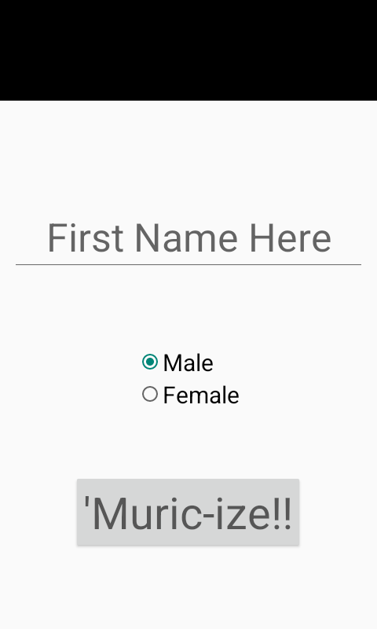
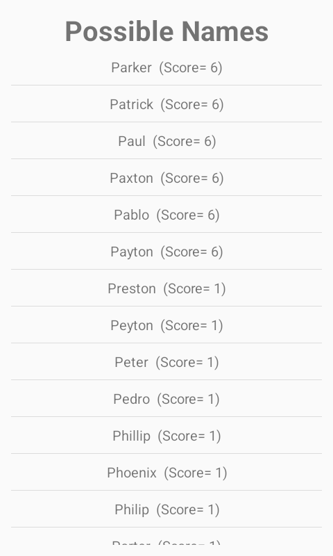

# Muricize

Muricize is a small Android app that takes a first name and ranks popular American names that start with the same letter. You type a name, choose male or female, and tap **'Muric-ize!!** A three-second eagle splash leads into the form. The suggestions come with the score the app used to order them.

It is a toy, not a translator. Two names score as close when they share an initial and a similar run of vowels. "Pranav" comes back Parker, Patrick, Paul. "Amy" ties every A name, because of a quirk in the original scorer described below.


## Where it came from

Pranav Prem wrote this on 11 February 2017 and pushed it the next day (`vanarp96@gmail.com`). He was in his first weeks of the MS in Computer Engineering at San Jose State University. Repos from the same month say so: CMPE 273 work under Prof. Sithu Aung is labeled in those project descriptions. Muricize is not. The commits, the original README, and the GitHub description never name a course, an internship, or an assignment.

The application id `com.unit401.pranav.muricize` is the package he chose in Android Studio. Nothing in this repo says what "unit401" means, so this refresh does not guess.

The project was generated on Windows. The IDE files that used to be checked in pointed at `C:\Program Files\Android\Android Studio`. The only follow-up commit added a Dropbox link to a packaged APK. That 2017 binary targeted Android 6-era APIs. Build from this tree instead of sideloading it.

The name lists are the U.S. Social Security top 1,000 boy and girl names for births in 2011, most popular first. Jacob and Sophia lead, and Elvis is the 904th boy name, which matches Social Security's May 2012 press release for that year.

## How it works

The app is offline. It asks for no permissions and does not use the network.

1. `SplashScreenActivity` shows the eagle for three seconds, then opens the form. Leaving the splash cancels that handoff.
2. `NameFinder` takes the first word of whatever was typed, title-cases it with a US locale, and requires a gender. Male starts selected. The gender value sent onward is the radio button's tag, `Male` or `Female`, not the visible label.
3. `DisplayResult` loads `assets/Male` or `assets/Female` and asks `Name` for matches.

`QuoteBank` is the asset reader. The class name is the original one; it loads names, not quotes.

A candidate is kept only when its first letter matches. Its score starts at 1 for that shared letter, then adds a vowel-overlap score:

- Only lowercase `a e i o u` count, so the capital first letter is never a vowel. `Amy` has no counted vowels and every A name ties at score 1.
- The matcher walks the input vowels and, for each one, scans the candidate's vowels from the beginning. A running counter of examined candidate vowels is not reset between input vowels. A match earns a position bonus only when that counter equals the input vowel's index.

Equal scores stay in file order, which is popularity order. The row format is unchanged: `Patrick  (Score= 6)`.

An empty name stays on the form. A name whose initial is missing from that gender's list (no girl name in this file starts with U) shows a short explanation instead of a blank screen. Those two cases used to throw.

## Run it today

You need JDK 21 and an Android SDK with platform 37. Android Studio's current release can open the project and will use the Gradle wrapper. From a terminal:

```bash
export ANDROID_HOME="$HOME/Android/Sdk"   # or wherever the SDK lives
./gradlew test lintDebug assembleDebug
```

The debug APK is `Muric-ize/build/outputs/apk/debug/Muric-ize-debug.apk`. On a device or emulator running Android 6.0 (API 23) or newer:

```bash
adb install -r Muric-ize/build/outputs/apk/debug/Muric-ize-debug.apk
```

`local.properties` holds the SDK path and is gitignored. Do not commit it.

| Command | What it does |
| --- | --- |
| `./gradlew test` | JVM tests for the matcher and the name lists |
| `./gradlew lintDebug` | Android lint |
| `./gradlew spotlessCheck` | Checks Java formatting |
| `./gradlew spotlessApply` | Rewrites Java to the formatter style |
| `./gradlew assembleDebug` | Builds the installable debug APK |

GitHub Actions runs test, lint, format check, and `assembleDebug` on every push and pull request.

## Tech stack

| | 2017 | This tree |
| --- | --- | --- |
| Language | Java 7 | Java 17 |
| UI | Android Support AppCompat 23.2.1 | AndroidX AppCompat 1.8.0 |
| Build | Android Gradle Plugin 2.2.3, Gradle 2.14.1, jcenter | Android Gradle Plugin 9.4.1, Gradle 9.6.0, Google Maven and Maven Central |
| SDK | min 19, compile/target 23 | min 23, compile/target 37 |
| Tests | A placeholder `2 + 2` test | JUnit 4.13.2 tests of the real matcher |
| Format | None | Spotless 8.10.4, google-java-format 1.36.1, AOSP 4-space style |
| CI | None | GitHub Actions, JDK 21 |

AppCompat 1.8.0 requires API 23, so the floor moved from KitKat (API 19) to Marshmallow. Gradle is pinned to 9.6.0 because that is the version Android Gradle Plugin 9.4.1 requires.

## Project structure

```
Muric-ize/
  src/main/java/com/unit401/pranav/muricize/
    SplashScreenActivity.java    three-second eagle, then the form
    NameFinder.java              first name and gender
    DisplayResult.java           ranked list
    beans/Name.java              normalize, filter, score, sort
    beans/PossibleNames.java     one row: name plus score
    util/Utilities.java          vowel heuristic
    util/QuoteBank.java          reads assets/Male and assets/Female
  src/main/assets/               2011 Social Security top 1,000, one name per line
  src/main/res/                  layouts, the eagle, launcher icons
  src/test/                      matcher tests, no device required
```

The module directory is `Muric-ize`, hyphen included. That name is the original one.

## Screens

The form, then the ranked list for Pranav:




Screenshots are from a Pixel 6 emulator on Android 14 running the debug build.
